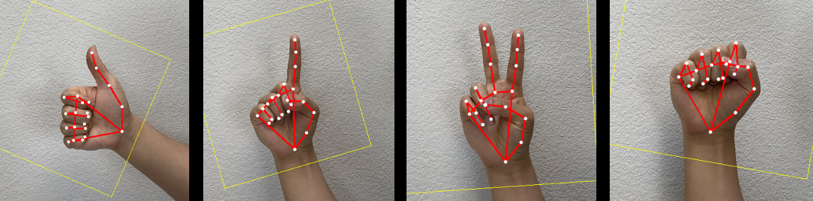
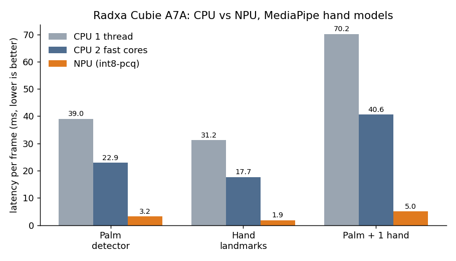

# MediaPipe hand tracking on the Radxa Cubie A7A NPU

Palm detector + hand landmark model from MediaPipe, converted to `.nb` files that run on the Allwinner A733 NPU of the Radxa Cubie A7A.
I wanted to see if MediaPipe's hand tracking could be moved off the CPU on this board. Short answer: yes, both networks convert, and on the NPU the two of them together take about 5 ms instead of about 40 ms on the two fast CPU cores.



*Output of `scripts/hands_demo.py` on four of the MediaPipe sample photos, both networks running on the NPU (int8). The yellow square is the rotated crop that goes into the landmark model.*

MediaPipe itself has no Allwinner NPU delegate, so this is only the two `.tflite` networks. Everything around them (letterboxing, anchor decoding, NMS, building the rotated crop, drawing) is plain Python/NumPy in `scripts/`.

## Results

Measured on the Radxa, model only (random input, 100-200 runs), batch 1.

| | NPU int8 (pcq) | NPU int16 | CPU, 2 fast cores | CPU, 1 thread |
|---|---|---|---|---|
| Palm detector (192x192) | **3.2 ms** | 7.7 ms (wrong output, see below) | 22.9 ms | 39.0 ms |
| Hand landmarks (224x224) | **1.85 ms** | 4.55 ms | 17.7 ms | 31.2 ms |

CPU numbers are the float `.tflite` files run with LiteRT 1.4.0 (XNNPACK); with 4 or 8 threads it gets slower, not faster, because the slow cores drag it. For comparison, an Intel i3-1005G1 laptop does 6.5 ms and 5.7 ms.



**Accuracy** (14 test photos, compared against the float model, boxes and landmarks decoded the same way):

- Palm detector int8: finds all 14 hands the float model finds, no false ones. Boxes are looser though, mean IoU against the float boxes is 0.79. That is fine here because the landmark model refines the hand afterwards.
- Hand landmarks int8: 0.86 px mean error on the 224x224 crop (worst crop 2.8 px). int16: 0.03 px.
- The test photos were mostly from the [HaGRID](https://github.com/hukenovs/hagrid) dataset plus MediaPipe's sample images. I haven't put them in the repo.

These times are the networks only. They don't include the camera, resizing, the crop warp, decoding or drawing, and I haven't measured the full MediaPipe pipeline, so don't read them as an end-to-end FPS number.

## What's in here

```
models/    ready-to-run .nb files for the A733 + their nbg_meta.json (input/output formats)
scripts/   conversion helpers, reference/compare scripts, hands_demo.py, nb_bench.cpp
docs/      pictures
```

Models: `palm_detector_int8pcq.nb`, `hand_landmark_int8pcq.nb`, `hand_landmark_int16.nb`. I did not include the palm int16 / uint8 builds because they don't work (below).

## What I used

- **Board:** Radxa Cubie A7A (Allwinner A733, 8x Cortex-A55, VeriSilicon Vivante NPU), Debian 11, kernel 5.15.147-a733. The NPU is driven through VIPLite with the `awnn_inference` wrapper that was already installed on my board (`~/awnn_inference`).
- **Converter:** the NPU toolchain docker image `ubuntu-npu:v2.0.10.1` (Acuity 6.30.22 + Vivante IDE 5.11), for the Allwinner A733 NPU. I didn't build it and I'm not redistributing it, so check Radxa's NPU documentation for where to get it. Everything below that says "in the container" runs there, with this repo mounted at `/workspace/mp` (for example `docker run -v $PWD:/workspace/mp ...`). The scripts assume that path.
- **Tools on the board:** `scripts/nb_bench.cpp` is a small timing / smoke-test program I wrote for `.nb` files. Build it on the board:

```
g++ -O2 -std=c++14 -pthread scripts/nb_bench.cpp -I ~/awnn_inference/include -L ~/awnn_inference/install/lib \
    -lawnn_inference -lNBGlinker -lVIPhal -Wl,-rpath,$HOME/awnn_inference/install/lib -o ~/nb_bench/nb_bench
export LD_LIBRARY_PATH=$HOME/awnn_inference/install/lib
~/nb_bench/nb_bench -m model.nb -n 100                      # latency with random input
~/nb_bench/nb_bench -m model.nb -n 1 -i0 input.bin -o out.bin   # real input (raw bytes), outputs saved as float32 (out.bin, out.bin.1, ...)
```

`scripts/board_eval.sh` wraps that: copy a model and a folder of `*.in.bin` files to the board, run them all, copy the outputs back.

## Try it on the board

```
python3 scripts/hands_demo.py photo.jpg out.png --palm models/palm_detector_int8pcq.nb --lm models/hand_landmark_int8pcq.nb --bench ~/nb_bench/nb_bench
```

It needs numpy and OpenCV in whatever Python you use on the board. It calls `nb_bench` for each network, so it reloads the models every time and is slow; it is there to show the data flow, not to be fast. `scripts/get_images.sh` downloads a few sample hand photos.

## How I converted them

Models come from MediaPipe's `hand_landmarker.task` (it is a zip with `hand_detector.tflite` and `hand_landmarks_detector.tflite`). `scripts/get_models.sh` fetches it.

1. **Check the ops.** `scripts/inspect_tflite.py` lists inputs/outputs and op types. Palm detector: 192x192x3 float input, outputs `(1,2016,18)` regressors and `(1,2016,1)` scores, ops are CONV_2D, DEPTHWISE_CONV_2D, PRELU, ADD, MAX_POOL_2D, PAD, RESIZE_BILINEAR, CONCATENATION and a lot of DEQUANTIZE (the weights are fp16). Landmark model: 224x224x3 in, outputs 63 landmark values (x, y, z in crop pixels), hand-presence, handedness and 63 world coordinates. Acuity imported all of it with 0 errors, nothing needed rewriting.
2. **Normalisation.** Both models take RGB in [0, 1], so mean 0 and scale 1/255 (0.0039216) go into the input meta and the board feeds raw uint8 RGB.
3. **Calibration data.** This matters, so use photos that look like your real input. I first calibrated the palm detector on scene photos with no hands in them, then replaced that with 40 letterboxed (black padding, aspect ratio kept) HaGRID photos before running any accuracy test, so I can't tell you how much difference it made. For the landmark model I used 47 *rotated hand crops*, made exactly the way the real pipeline makes them: run the float palm detector, take the box + keypoints, rotate so the wrist-to-middle-finger axis is vertical, scale the box by 2.6 and shift it. `scripts/make_calib.py` does both sets from a folder of photos.
4. **Convert.** In the container: `bash scripts/mp_convert.sh palm_det hand_detector.tflite /workspace/mp/calib192h/dataset.txt 0 0.0039216 pcq` and the same for `hand_lm` with `calib224` and `pcq i16`. It imports, quantises (47 iterations; my 40-image palm set still worked), and exports with the A733 target. The `.nb` ends up in `<dir>/out_<q>_nbg_unify/network_binary.nb`.
5. **Pre/post-processing on the CPU.** `lb.py` (letterbox), `palm_decode.py` (2016 anchors = 24x24x2 + 12x12x6, 7 keypoints per hand, score threshold 0.5, NMS 0.3), `palm_roi.py` (rotated ROI, rotation from keypoint 0 to keypoint 2, scale 2.6, shift -0.5).
6. **Check.** `palm_ref.py` / `lm_ref.py` write float-TFLite reference outputs, `palm_sim.sh` runs the Acuity simulator, `board_eval.sh` runs the board; then compare.

## What didn't work / caveats

- **Palm detector int16 is broken on the board.** The Acuity simulator gives a perfect result for the int16 model (correlation 1.000 with float), but the compiled `.nb` on the board returns garbage (it found 2 of 14 hands, with a score correlation of ~0.14). I don't know why; the landmark model's int16 build is fine, and the BlazeFace one too. uint8 was also bad (4 of 14). int8 per-channel is the one that works for this network, which is the opposite of what I saw on BlazeFace.
- Only a single image size, no tracking between frames (MediaPipe skips the palm detector when it can track from the previous landmarks; I haven't built that part).
- Handedness output is converted but I haven't checked which value means left or right.
- The NPU has one core and no preemption, so if you run several models at once their times add up.

## Things that cost me time (Acuity / A733 in general)

These are not specific to this model, so if you convert something else you will probably hit them too.

1. **Export for the right chip.** `--optimize VIP9000NANODI_PLUS_PID0X1000003B` is the A733. An older target I tried first (`VIP9A00NANOQI_PID0X10001029`) gave empty `.nb` files and "Fatal model generation error".
2. **Use `pegasus_patched.py`.** The plain `pegasus.py` in my container failed because there was no torch installed. `env.sh` sets `$PEG` to the patched one.
3. **Put the normalisation on the NPU.** In the input meta I set `add_preproc_node: true`, `reverse_channel: false` and per-channel mean/scale, so the board feeds raw uint8 RGB. Same for the output: `add_postproc_node: true` gives you float32 outputs, which is all the wrapper's output reader understands.
4. **`reverse_channel: false` matters.** The generated default is `true`, which silently flips the channel order of the calibration data. For images that just hurts accuracy a bit; for non-image tensors it scrambled everything (see the SmolLM2 repo).
5. **Always compare the quantised simulator with the float model before trusting a `.nb`**, and then compare the board with the simulator. They do not always agree (see the palm detector below).
6. **Quantisation choice is per model.** int8 per-channel (`pcq`) is fast and fine for some networks, wrecks others; `int16` (`dynamic_fixed_point`) is about 1.5-3x slower but usually close to lossless.

## Credits

Models and the processing recipe are from [MediaPipe](https://github.com/google-ai-edge/mediapipe) (Apache-2.0). The sample photos in the picture are from MediaPipe's test assets.

## Licence

The scripts and docs here are MIT (see `LICENSE`). The neural networks are not mine and keep their own licences; check the model card of the original before reusing a converted `.nb`.
